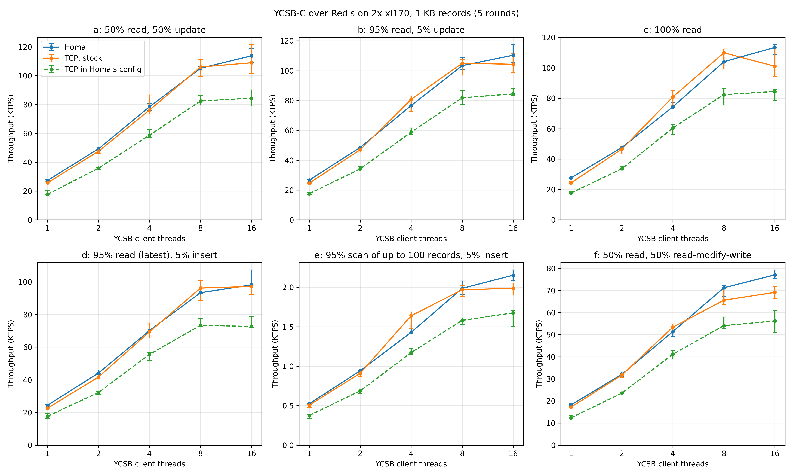
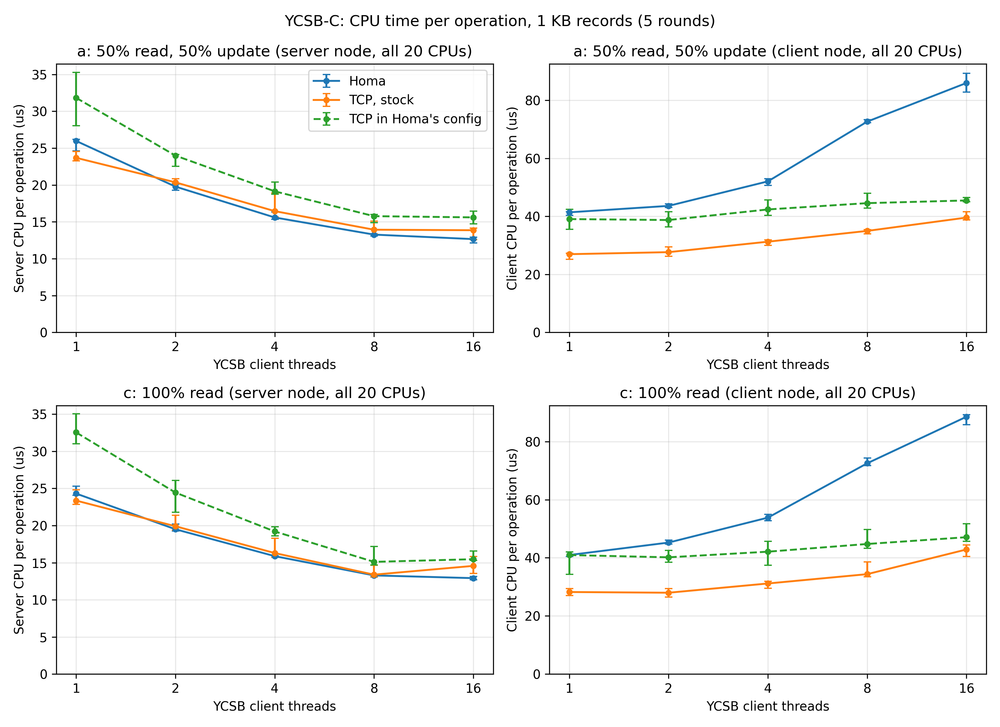
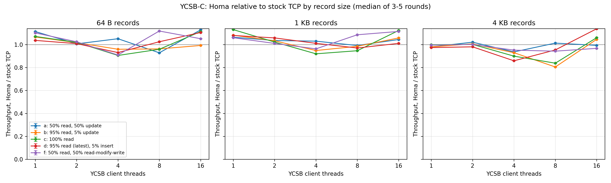
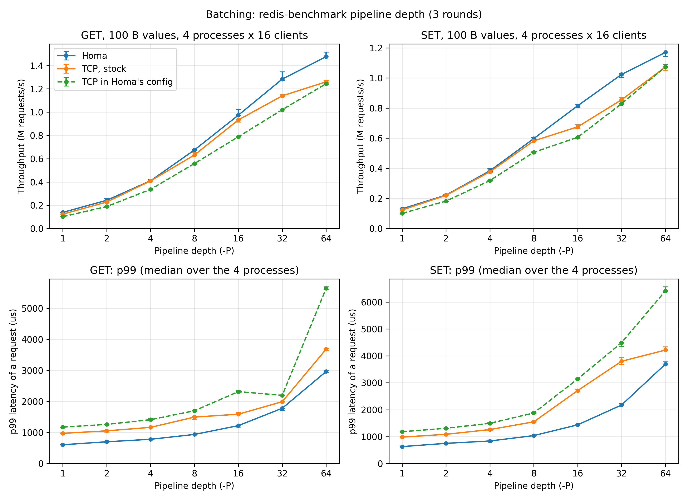
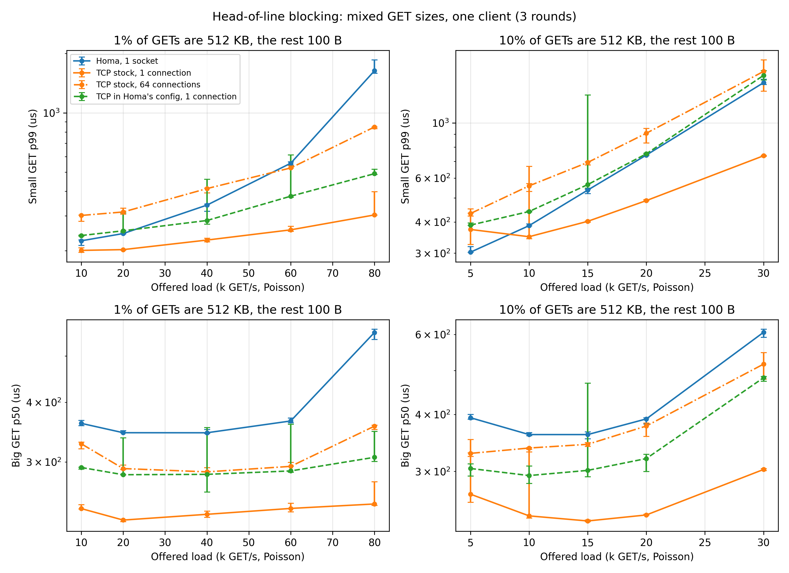
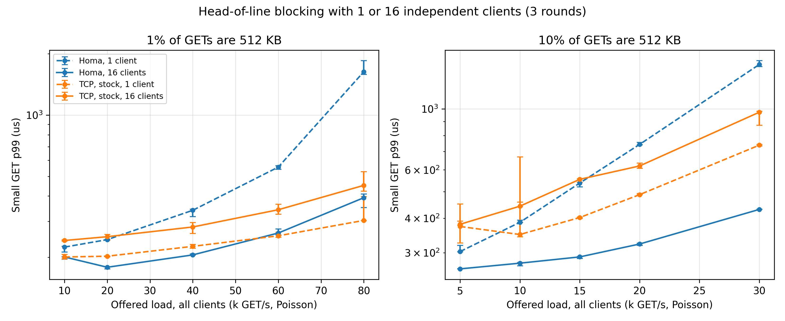
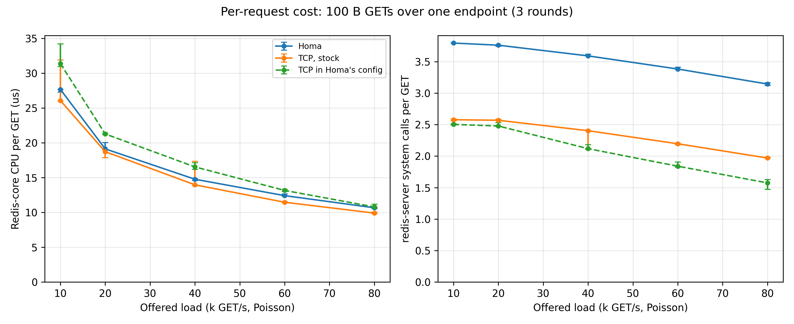
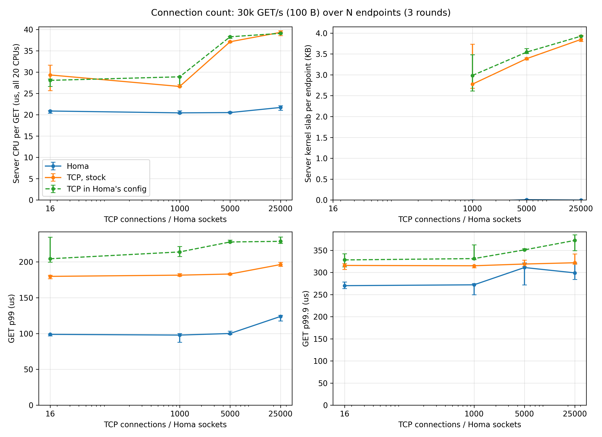

# Homa vs TCP for Redis on CloudLab xl170

Runbook, scripts, raw results and figures for Redis over this repository's Homa transport against
TCP, on 2x CloudLab Utah xl170 nodes (25 Gb/s) with upstream Homa in its official CloudLab
configuration. Six experiments: YCSB-C (one operation per request; the six standard workloads, with
64 B, 1 KB and 4 KB records), batching (`redis-benchmark -P`), head-of-line blocking (a mix of 100 B
and 512 KB GETs, from one client or several), the cost of one request over one endpoint, connection
count (up to 25,000 endpoints) and the server cost of one 512 KB reply.

TCP is measured two ways, because Homa's official configuration changes TCP's path too:

| Line | Host state | How |
|---|---|---|
| Homa | Homa's official config (`config default`) | as installed |
| **TCP, stock** (the baseline) | `homa.ko` unloaded: kernel default qdisc (`mq` + `fq_codel`), RSS only (no RPS/RFS) | `tcpclean.sh on` |
| TCP in Homa's config | the official config shared with Homa | how Homa's own TCP comparisons run |

In Homa's config TCP runs with three Homa mechanisms in its way: RPS/RFS (`config rps`, which Homa's
SoftIRQ steering needs; it moves TCP's receive processing onto the application core, here the one
Redis core), the `sch_homa` qdisc and its pacer thread on every TX queue, and the TCP GRO hook that
`homa.ko` installs when it loads (TCP hijacking support, active even with `hijack_tcp=0`). NIC
coalescing, CPU governor and C-states are the same for all three lines.

## Findings

- **One operation per request (YCSB-C, workloads a-f, 1 KB records): Homa is 0.87-1.13x stock TCP**,
  with server CPU per operation within 13% of it and 1.5-2.2x the client CPU (a blocked Homa receiver
  spins for `net.homa.poll_usecs` = 50 us before sleeping; stock TCP does not poll). With 64 B
  records it is 0.91-1.13x, with 4 KB records 0.80-1.14x, where stock TCP leads at 4-8 threads in
  most workloads (workloads a, b, c, d, f). Against TCP in Homa's config Homa is 1.22-1.56x: the config itself costs
  TCP 16-31%.
- **Batching**: pipelining lifts all three lines about tenfold (0.10-0.14 M requests/s at `-P 1`,
  1.1-1.5 M at `-P 64`, 64 clients), and Homa stays at 1.00-1.21x stock TCP's throughput at every
  depth, with an 11-47% lower p99. Without batching by the client, one TCP connection batches by
  itself under load: a read or a write carries 1.2 GETs at 10k GET/s and 1.5 at 80k (1.9 in Homa's
  config), while Homa receives one message per `recvmsg` and sends one per reply, plus a `recvmsg`
  that finds nothing each time it drains the socket (1.5-1.8 per GET). The Redis core then spends
  2-8% more per GET over Homa than over one stock-TCP connection, the whole server node 5-11% more,
  and at 80k GET/s the core is 86% busy against 79%. At 40k GET/s the core's extra 1.6 us per GET are
  0.6 us of system calls, 0.7 us of protocol (0.3 us of it the time tracing upstream Homa always
  records) and about 0.2 us each of memory allocation, IOMMU mapping, NIC driver and event loop, less
  0.4 us of interrupt and scheduler work.
- **Head-of-line blocking: Homa wins with many clients and loses with one.** Redis runs one
  client's commands in order on one thread, so a small request behind a big one waits for the big
  reply's server work whatever the transport; Homa can only remove the wait behind it on the wire and
  in the byte stream. With 16 independent clients (one process and one endpoint each), Homa gives a
  lower small-GET p99 than stock TCP at every load: by 13-29% when 1% of the GETs fetch 512 KB and by
  31-56% when 10% do; with 8 clients at every load but 80k GET/s with 1% big GETs, with 4 at every
  load but 60k and 80k GET/s with 1%. With one client, stock TCP is ahead everywhere but the lowest
  load with 10% big GETs (there Homa is 19% lower), by up to 5.4x at 80k GET/s with 1% (1634 against
  304 us). A single-threaded client gets each 512 KB reply over Homa as one message and handles it in
  one piece, holding back the requests due meanwhile (their send lag p99 reaches 662 against 188 us),
  where over TCP it reads the reply in pieces; and one TCP connection carries several requests per
  read and write while Homa pays for every RPC (see Batching). More clients spread both costs, while
  more TCP connections from one client make TCP worse.
- **A 512 KB GET is 1.5-2.3x slower over Homa with one client, 1.1-1.2x with 16**; the transport
  alone is 14% slower for one 512 KB message (271 against TCP's 237 us; 17 against 29 us for 100 B).
  A 512 KB reply costs the Redis core 104 us over Homa and 90 us over stock TCP, and the whole server
  node 3.1x stock TCP's (430 against 137 us), most of it off the Redis core.
- **Homa's clearest win is connection count**: from 16 to 25,000 endpoints stock TCP's server CPU per
  GET rises from 29.3 to 39.3 us (on the Redis core from 15.3 to 17.5 us), plus 2.8-3.8 KB of kernel
  slab per connection; Homa stays at 20.5-21.7 us, with no per-client kernel memory on the server, and
  its GET p99 is lower (98-124 against 180-196 us).

This branch is an orphan: it shares no history with the Redis code.

| Path | What |
|---|---|
| `install-mainline-kernel.sh` | installs mainline 6.17.8 with `mitigations=off` on a node (run as root, then reboot) |
| `ycsb-xl170.sh` | YCSB-C, runs on node1 against redis-server on node0 |
| `batch-xl170.sh` | batching curve with `redis-benchmark -P` |
| `mixload.c`, `mixload-xl170.sh` | open-loop load generator and its driver: `hol`, `multi`, `scale`, `bigcost`, `rpc` |
| `prof-core.sh` | where the Redis core's time goes: a perf profile of it at 40k GET/s, by symbol |
| `cpnode-xl170.sh` | the transport alone: Homa's `cp_node`, one message and a 100 B reply |
| `need-ack-probe.sh` | Homa server RPCs left by clients that close without waiting, by the client host's ICMP rate limit |
| `tcpclean.sh` | switches both nodes to stock TCP (`on`) and back to Homa's config (`off`) |
| `busy-cores.sh` | per-CPU busy % over an interval as MPERF/TSC, the time a CPU executed (all drivers use it) |
| `plot.py` | plain matplotlib, `results/` -> `figures/` (300 dpi PNG), and prints the tables below |
| `results/xl170-upstream-1c59d7b6/` | raw CSVs (one row per run; `-tcpclean` = stock TCP) and `env.txt` |
| `figures/` | the figures below |

## Setup

| Item | Value |
|---|---|
| Nodes | 2x CloudLab Utah xl170, one LAN: node0 = 10.0.1.1 (Redis), node1 = 10.0.1.2 (clients) |
| CPU | Intel Xeon E5-2640 v4, 10 cores / 20 hardware threads, 1 socket |
| NIC | Mellanox ConnectX-4, 25 Gb/s, `mlx5_core`, experiment port `ens1f1np1`, 20 RX queues (queue i interrupts CPU i) |
| OS / kernel | Ubuntu 24.04, mainline 6.17.8-061708-generic, `mitigations=off` |
| Homa | PlatformLab/HomaModule `main` @ `1c59d7b6` (2026-09-25): module, `util/`, `cloudlab/`; as upstream's tree, it records time traces always (`ENABLE_TIME_TRACE 1`) |
| IOMMU | on, DMA translated with lazy flushing (the mainline kernel's `CONFIG_INTEL_IOMMU_DEFAULT_ON`); the same for every line |
| Redis / YCSB | uoenoplab/smt-redis `main` @ `f749cd4dd`, uoenoplab/smt-YCSB-C `main` @ `eea5db7` |
| Redis server | one instance, `--io-threads 1`, pinned to node0 CPU 7; serves TCP (6379) and Homa (2000) |

## 1. Provision

Launch CloudLab's `small-lan` profile yourself: 2 nodes, hardware type `xl170` (Utah), image
Ubuntu 24.04 (`UBUNTU24-64-STD`).

- Put the LAN on 10.0.1.x (node i = 10.0.1.{i+1}), for example in a copy of the profile.
  `cloudlab/bin/config` finds the experiment NIC by that prefix and fails with "Couldn't identify
  vlan interface" on small-lan's default 10.10.1.x.
- On-demand xl170 is often reservation-blocked (`failure_code 26`, "0 available because of existing
  resource reservations", even when the free count is above 0). Reserve nodes on the portal then.

Below, `N0` / `N1` are the ssh targets of node0 / node1 and
`K="-i <your CloudLab key> -o StrictHostKeyChecking=no -o UserKnownHostsFile=/dev/null -o LogLevel=ERROR"`.
Install the mainline kernel on both nodes and check it after the reboot:

```bash
for n in $N0 $N1; do scp $K install-mainline-kernel.sh $n: && ssh $K $n 'sudo bash install-mainline-kernel.sh && sudo reboot'; done
for n in $N0 $N1; do ssh $K $n 'uname -r; grep -o mitigations=off /proc/cmdline'; done   # 6.17.8-061708-generic, mitigations=off
```

## 2. Deploy Homa and the official config

Build upstream `main` on node0; `install_homa` copies `homa.ko` and the tools to both nodes and runs
`config default` on each.

```bash
for n in $N0 $N1; do   # inter-node ssh (install_homa and the drivers ssh node0/node1) and build deps
  rsync -t -e "ssh $K" <your CloudLab key> $n:.ssh/id_ed25519
  ssh $K $n 'chmod 600 ~/.ssh/id_ed25519
    printf "Host node*\n  StrictHostKeyChecking no\n  UserKnownHostsFile /dev/null\n  LogLevel ERROR\n" >> ~/.ssh/config
    sudo apt-get update -qq && sudo DEBIAN_FRONTEND=noninteractive apt-get install -y -qq gcc-14 libtbb-dev'
done
# Stage upstream main (the files cloudlab/update copies, without its global git config step)
git clone https://github.com/PlatformLab/HomaModule && git -C HomaModule checkout 1c59d7b6
git -C HomaModule archive HEAD | ssh $K $N0 'mkdir -p ~/homaModule ~/bin && tar x -C ~/homaModule && cd ~/homaModule &&
  cp -r cloudlab/bin/. ~/bin/ && cp cloudlab/bash_profile ~/.bash_profile && cp cloudlab/bashrc ~/.bashrc && cp cloudlab/gdbinit ~/.gdbinit'
ssh $K $N0 'cd ~/homaModule && make -j20 CC=gcc-14 && make -j20 -C util'   # the 6.17.8 kernel was built with gcc-15
ssh $K $N0 'bash -lc "~/bin/install_homa 2"'                               # installs sch_homa too
for n in $N0 $N1; do ssh $K $n 'echo performance | sudo tee /sys/devices/system/cpu/cpu*/cpufreq/scaling_governor >/dev/null
  sudo sysctl -qw net.ipv4.icmp_ratelimit=0'; done
```

- `config power` calls `cpupower`, which has no build for the mainline kernel, hence the governor
  line (that is all it sets; on Intel it deliberately leaves C-states on, to keep Turbo).
- `icmp_ratelimit=0`: a Homa server RPC whose client socket closed before the reply arrived (a Redis
  client ending with QUIT, which Homa cannot follow with a FIN) waits for an ACK that never comes, and
  Homa never times it out: `homa_timer` sends it a NEED_ACK every 1 ms tick until an ICMP port
  unreachable from the client host aborts it, and Linux by default sends those to a host about once
  a second. Without the rate limit they go at once. 20 `redis-cli --homa ping` leave 12k NEED_ACK/s
  behind with the default and none without it (`need-ack-probe.sh`, `results/.../need-ack-probe.txt`).
- To replace a loaded `homa.ko`, run `config reset_qdisc` first: `sch_homa` holds a reference to the
  module. Homa's receiver spin is `net.homa.poll_usecs` (not `busy_usecs`, the load balancer's
  threshold).

Check both nodes before measuring (`results/.../env.txt` has this run's values):

| Check | Expected |
|---|---|
| `/sys/module/homa/srcversion` | identical on both (`67209D508FA06400C737416` for `1c59d7b6` + gcc-14) |
| `scaling_governor` | `performance` on all 20 CPUs |
| `ethtool -c ens1f1np1` / `-k` | adaptive-rx off, rx-usecs 0, rx-frames 1, tx-usecs 5; `ntuple-filters: off` |
| `tc qdisc show dev ens1f1np1` | 20x `homa` under `mq` |
| `rx-*/rps_cpus`, `rps_flow_cnt`, `rps_sock_flow_entries` | `fffff`, 2048, 32768 |
| `sysctl net.homa` | `link_mbps` 25000, `num_priorities` 8, `unsched_bytes` 60000, `max_incoming` 480000, `gro_policy` 114, `poll_usecs` 50, `hijack_tcp` 0 |
| `net.core.busy_poll`, `busy_read` | 0, 0 |

## 3. Build Redis, YCSB-C and mixload

```bash
for n in $N0 $N1; do (   # from local clones of smt-redis and smt-YCSB-C
  git -C smt-redis  archive --prefix=smt-redis/  f749cd4dd | ssh $K $n 'tar x -C ~'
  git -C smt-ycsb-c archive --prefix=smt-ycsb-c/ eea5db7 | ssh $K $n 'tar x -C ~'
  ssh $K $n 'cd ~/smt-redis && make -j20 && cd ~/smt-ycsb-c && make'   # YCSB-C: plain make, its Makefile races under -j
  scp $K busy-cores.sh $n:
) & done; wait
scp $K ycsb-xl170.sh batch-xl170.sh mixload.c mixload-xl170.sh prof-core.sh cpnode-xl170.sh need-ack-probe.sh tcpclean.sh $N1:
ssh $K $N1 'D=~/smt-redis/deps; gcc -O2 -o ~/mixload ~/mixload.c -I$D/hiredis -I$D/homa $D/hiredis/libhiredis.a -lm'
```

## 4. Placement

Homa has no L4 ports, so the node0-node1 pair lands on one RX queue per host: its NAPI (IRQ) core
is fixed by the IP pair. Keep the applications off each host's NAPI core and its hyperthread sibling
(CPU i+10). To find it, run any Homa load between the nodes and see which CPU takes the NET_RX
softirqs on each host:

```bash
a=$(grep NET_RX /proc/softirqs); sleep 2; b=$(grep NET_RX /proc/softirqs)
paste <(echo $a | tr ' ' '\n' | tail -n +2) <(echo $b | tr ' ' '\n' | tail -n +2) | awk '{print "cpu" NR-1, $2-$1}' | sort -k2 -n | tail -3
```

Here NAPI was node0 CPU 1 and node1 CPU 4, so the drivers pin redis-server to node0 CPU 7 (`SPIN`);
YCSB-C may use every node1 CPU except 4 and 14 (`YCPUS`), mixload runs on node1 CPU 8 (`multi`: one
process each on CPUs 5-13, 15-19, 0, 1), and the four redis-benchmark processes on CPUs 8-11; edit
those lines if yours differ. Pin both sides: unpinned, placement alone can swing Homa by ~25% run to
run.

## 5. Run

Everything runs on node1 in tmux (about 10 hours); every run starts on a fresh redis-server.

```bash
ssh $K $N1 'tmux new -d -s run "W=\"workloada workloadb workloadc workloadd workloadf\"
  ycsb() { ROUNDS=5 WORKLOADS=\"\$W workloade\" bash ycsb-xl170.sh > ycsb-xl170\$1.csv
    ROUNDS=3 WORKLOADS=\"\$W\" FIELDS=\"8 8\" bash ycsb-xl170.sh > ycsb-xl170-64B\$1.csv
    ROUNDS=3 WORKLOADS=\"\$W\" FIELDS=\"40 100\" bash ycsb-xl170.sh > ycsb-xl170-4KB\$1.csv; }
  mix() { bash batch-xl170.sh > batch\$1.csv
    for m in hol scale bigcost rpc multi; do bash mixload-xl170.sh \$m > mixload-\$m\$1.csv; done; }
  ycsb; mix; bash prof-core.sh \"\" homa tcp; bash cpnode-xl170.sh > cpnode.csv; bash need-ack-probe.sh > need-ack-probe.txt
  bash tcpclean.sh on; export TRANSPORTS=tcp; ycsb -tcpclean; mix -tcpclean
  bash prof-core.sh -tcpclean tcp; bash tcpclean.sh off"'
```

- In Homa's config the drivers interleave Homa and TCP at every point (`multi` was run for Homa
  only, `TRANSPORTS=homa`, since it compares Homa with stock TCP). The stock-TCP runs form one block
  after them, since `homa.ko` can only be unloaded with no Homa socket open.
- **YCSB-C** (`ycsb-xl170.sh`): the standard workloads a (50% read / 50% update), b (95% read / 5%
  update), c (100% read), d (95% read of the latest keys / 5% insert), e (95% scan of up to 100
  records / 5% insert) and f (50% read / 50% read-modify-write), zipfian (d: latest), 100k records of
  10 x 100 B fields (1 KB), 1-16 client threads, each with its own connection or socket and one
  request in flight, 5 rounds. As in the SMT paper, a, b, c, d and f also run with 64 B (8 x 8 B) and
  4 KB (40 x 100 B) records (`FIELDS`), 3 rounds. Each run loads, then runs 500k-2M operations
  (>= ~15 s; a fiftieth of that for e, whose scans read ~50 records each). Scan works as in YCSB's own
  Redis binding: every inserted key also goes into a sorted set scored by its Java `hashCode()`, and a
  scan reads the keys from the start key's score on, then each record. CPU is sampled on all 20 CPUs
  of both nodes for 4 s, starting 1 s after the load phase ends; `*_busy_sum` is a node's total in
  hardware threads x 100 (idle: 9 in Homa's config, whose kernel threads run, and 5 with stock TCP).
- **Batching** (`batch-xl170.sh`): `redis-benchmark -t get|set -d 100 -P 1..64`, 4 processes x 16
  clients, 3 rounds; throughput is the sum over the processes, latency the median of theirs.
- **mixload** (`mixload.c`): GETs with Poisson arrivals (fixed seed, so every configuration sees the
  same request sequence) from one spinning thread, which sends and receives like a single-threaded
  application: while it handles a reply, the requests due wait, and `lag_*` is how late they left
  their schedule. Latency runs from a request's scheduled arrival to its reply, so that wait counts.
  TCP: N connections, each pipelined, read 64 KB at a time and parsed as it comes; Homa: one socket
  (or N), any number of RPCs in flight, each response matched to its request by the RPC's id, and a
  response arrives whole. A request goes to an idle endpoint (least recently used) if there is one,
  else to the least loaded. A run counts only if every reply is the value asked for (`bad` = 0).
  - `hol`: 1% or 10% of the GETs fetch a 512 KB value, the rest 100 B; TCP over 1-64 connections,
    Homa over 1 socket; 10 s runs (the first second not recorded), 3 rounds.
  - `multi`: the same mix and total loads from K = 4, 8 or 16 independent clients, each a mixload
    process with one endpoint, its own CPU and its own arrival schedule (`MIXSEED`); their latencies
    are pooled (`LATDUMP`) before the percentiles are taken.
  - `scale`: 30k GET/s of 100 B over 16-25,000 connections or sockets; server CPU and memory sampled
    mid-run and before it, once node0 is idle.
  - `bigcost`: 1000 GET/s of only 100 B or only 512 KB values over one endpoint: the difference is
    the server's cost of a 512 KB reply.
  - `rpc`: only 100 B GETs over one endpoint at 10k-80k GET/s; server CPU and redis-server's system
    calls counted mid-run for 4 s.
- **Transport alone** (`cpnode-xl170.sh`): Homa's own `cp_node`, one RPC outstanding, a request of
  100 B / 64 KB / 512 KB and a 100 B reply (`--one-way`), 3 rounds of 10 s. Each side gets two CPUs:
  a Homa receiver thread polls, and pinned to one CPU with its sender it inflates the tail.
- CPU is counted as MPERF/TSC (`busy-cores.sh`), not from /proc/stat: this kernel has no
  `CONFIG_IRQ_TIME_ACCOUNTING`, so /proc/stat samples ticks, and an otherwise idle CPU has its tick
  stopped; it misses most interrupt work there (stock TCP's receive path, Homa's SoftIRQ core). `perf`
  is the image's `linux-tools` one: `/usr/bin/perf` refuses a kernel it has no package for.
- Keep open-loop Homa load below saturation (~80k GET/s over one socket here). Overloaded, the client
  node's mlx5 TX queues can time out, after which `sch_homa` holds back every TCP packet of 1000 B or
  more until `config reset_qdisc && config qdisc` replaces it.
- Use `-host`/`-h 10.0.1.1`, not `node0`: after `config ipv6`, `node0` resolves to `fd00::1` first;
  the Homa client needs an IPv4 literal and TCP would silently run over IPv6.

## 6. Figures and tables

```bash
rsync -t -e "ssh $K" "$N1:*.csv" "$N1:prof-core-*.txt" "$N1:need-ack-probe.txt" results/xl170-upstream-1c59d7b6/
uv run --with matplotlib python plot.py
```

## Results

### YCSB-C: one operation per request (1 KB records, 5 rounds)

| Workload | Threads | Homa KTPS | TCP, stock KTPS | TCP in Homa's config KTPS | Homa / stock TCP | Server us/op (Homa / stock TCP) | Client us/op (Homa / stock TCP) |
|---|---|---|---|---|---|---|---|
| workloada | 1 | 27.4 (27.0-27.8) | 25.7 (25.0-26.6) | 17.7 (17.4-20.5) | 1.06 | 26.0 / 23.7 | 41.4 / 27.0 |
| workloada | 2 | 49.3 (48.2-50.5) | 47.6 (46.2-48.4) | 35.9 (34.7-36.5) | 1.04 | 19.8 / 20.4 | 43.6 / 27.7 |
| workloada | 4 | 78.5 (75.8-80.6) | 76.2 (73.5-86.5) | 58.7 (57.2-62.8) | 1.03 | 15.6 / 16.4 | 52.1 / 31.3 |
| workloada | 8 | 105.2 (103.3-106.1) | 106.1 (99.5-111.0) | 82.4 (79.6-86.1) | 0.99 | 13.3 / 13.9 | 72.7 / 35.0 |
| workloada | 16 | 113.8 (109.3-118.7) | 109.0 (101.5-121.5) | 84.4 (79.1-90.2) | 1.04 | 12.7 / 13.9 | 86.0 / 39.6 |
| workloadb | 1 | 26.6 (26.0-27.1) | 24.6 (24.2-25.2) | 17.5 (16.9-18.5) | 1.08 | 25.3 / 23.7 | 42.4 / 27.3 |
| workloadb | 2 | 48.5 (47.8-48.8) | 47.0 (45.3-48.7) | 34.2 (33.7-36.0) | 1.03 | 19.3 / 20.2 | 44.7 / 27.9 |
| workloadb | 4 | 76.6 (72.7-80.3) | 80.8 (72.4-83.1) | 58.8 (57.4-61.6) | 0.95 | 15.9 / 16.5 | 53.2 / 31.8 |
| workloadb | 8 | 103.4 (100.6-108.6) | 104.9 (97.0-107.2) | 81.8 (77.4-86.6) | 0.98 | 13.4 / 13.8 | 72.6 / 34.4 |
| workloadb | 16 | 110.3 (105.3-117.4) | 104.3 (98.7-111.7) | 84.4 (83.2-88.2) | 1.06 | 13.1 / 13.8 | 87.6 / 41.0 |
| workloadc | 1 | 27.5 (27.0-28.1) | 24.3 (24.1-25.3) | 17.6 (17.5-18.5) | 1.13 | 24.3 / 23.4 | 41.0 / 28.2 |
| workloadc | 2 | 47.6 (46.8-48.6) | 46.5 (43.4-48.4) | 33.6 (33.2-34.9) | 1.02 | 19.5 / 19.9 | 45.2 / 28.0 |
| workloadc | 4 | 74.4 (74.2-77.0) | 80.9 (75.2-85.0) | 60.5 (56.0-62.8) | 0.92 | 15.9 / 16.3 | 53.8 / 31.2 |
| workloadc | 8 | 104.0 (101.8-107.0) | 109.9 (99.1-112.4) | 82.4 (75.5-86.5) | 0.95 | 13.3 / 13.4 | 72.5 / 34.4 |
| workloadc | 16 | 113.4 (108.9-115.3) | 101.0 (94.2-112.9) | 84.4 (78.3-85.9) | 1.12 | 12.9 / 14.6 | 88.6 / 42.9 |
| workloadd | 1 | 24.4 (23.4-25.0) | 22.6 (21.7-24.0) | 17.7 (16.4-19.2) | 1.08 | 27.5 / 26.1 | 45.8 / 28.6 |
| workloadd | 2 | 44.2 (44.0-46.0) | 41.8 (40.5-43.4) | 32.3 (31.2-32.9) | 1.06 | 21.3 / 22.6 | 48.4 / 30.9 |
| workloadd | 4 | 70.2 (66.9-73.7) | 69.4 (65.7-74.8) | 55.6 (51.9-56.6) | 1.01 | 17.6 / 18.4 | 58.1 / 35.1 |
| workloadd | 8 | 93.3 (93.0-97.4) | 96.2 (88.8-100.7) | 73.4 (72.5-77.7) | 0.97 | 14.5 / 14.9 | 78.2 / 37.8 |
| workloadd | 16 | 98.2 (97.5-107.3) | 97.1 (92.1-98.7) | 72.7 (72.0-78.7) | 1.01 | 14.3 / 15.7 | 95.3 / 44.4 |
| workloade | 1 | 0.52 (0.51-0.53) | 0.51 (0.48-0.51) | 0.38 (0.34-0.39) | 1.03 | 1297.4 / 1188.2 | 2140.9 / 1312.5 |
| workloade | 2 | 0.94 (0.90-0.95) | 0.91 (0.87-0.94) | 0.69 (0.66-0.70) | 1.04 | 1006.4 / 1051.1 | 2268.7 / 1387.2 |
| workloade | 4 | 1.43 (1.42-1.52) | 1.64 (1.47-1.69) | 1.17 (1.15-1.23) | 0.87 | 820.5 / 815.0 | 2761.1 / 1498.8 |
| workloade | 8 | 1.99 (1.91-2.08) | 1.97 (1.89-2.02) | 1.58 (1.53-1.61) | 1.01 | 688.8 / 709.2 | 3706.2 / 1665.8 |
| workloade | 16 | 2.15 (2.08-2.22) | 1.99 (1.90-2.05) | 1.68 (1.50-1.70) | 1.08 | 664.9 / 747.4 | 4292.7 / 1984.6 |
| workloadf | 1 | 18.2 (17.5-18.8) | 17.2 (16.8-17.6) | 12.4 (12.0-13.5) | 1.06 | 39.6 / 35.4 | 61.9 / 39.5 |
| workloadf | 2 | 32.1 (31.0-33.1) | 31.7 (30.7-32.1) | 23.6 (23.2-23.7) | 1.01 | 29.7 / 31.5 | 67.6 / 41.4 |
| workloadf | 4 | 51.4 (49.3-53.6) | 53.4 (51.7-54.9) | 41.2 (38.9-42.7) | 0.96 | 23.4 / 24.8 | 77.4 / 46.4 |
| workloadf | 8 | 71.2 (67.4-72.2) | 65.6 (63.5-71.0) | 54.1 (52.9-58.0) | 1.09 | 19.8 / 22.7 | 107.7 / 51.7 |
| workloadf | 16 | 77.1 (75.3-79.3) | 69.2 (66.5-71.9) | 56.2 (50.9-60.9) | 1.11 | 18.8 / 21.6 | 128.2 / 59.5 |




By record size, workloads a, b, c, d and f (64 B and 4 KB: 3 rounds):

| Workload | Threads | 64 B: Homa / TCP stock KTPS (ratio) | 1 KB: Homa / TCP stock KTPS (ratio) | 4 KB: Homa / TCP stock KTPS (ratio) |
|---|---|---|---|---|
| workloada | 1 | 28.7 / 25.8 (1.11) | 27.4 / 25.7 (1.06) | 18.7 / 19.1 (0.98) |
| workloada | 2 | 49.7 / 49.4 (1.01) | 49.3 / 47.6 (1.04) | 35.3 / 34.5 (1.02) |
| workloada | 4 | 83.1 / 79.1 (1.05) | 78.5 / 76.2 (1.03) | 57.8 / 61.7 (0.94) |
| workloada | 8 | 108.6 / 117.0 (0.93) | 105.2 / 106.1 (0.99) | 79.7 / 78.7 (1.01) |
| workloada | 16 | 119.6 / 106.0 (1.13) | 113.8 / 109.0 (1.04) | 90.2 / 90.8 (0.99) |
| workloadb | 1 | 28.5 / 26.8 (1.07) | 26.6 / 24.6 (1.08) | 14.4 / 14.7 (0.98) |
| workloadb | 2 | 49.8 / 49.0 (1.02) | 48.5 / 47.0 (1.03) | 28.3 / 28.2 (1.01) |
| workloadb | 4 | 82.7 / 86.2 (0.96) | 76.6 / 80.8 (0.95) | 47.6 / 51.2 (0.93) |
| workloadb | 8 | 105.4 / 109.6 (0.96) | 103.4 / 104.9 (0.98) | 61.1 / 75.9 (0.80) |
| workloadb | 16 | 112.1 / 113.0 (0.99) | 110.3 / 104.3 (1.06) | 77.3 / 73.9 (1.05) |
| workloadc | 1 | 28.5 / 26.6 (1.07) | 27.5 / 24.3 (1.13) | 14.1 / 14.1 (1.00) |
| workloadc | 2 | 50.6 / 49.7 (1.02) | 47.6 / 46.5 (1.02) | 28.2 / 28.2 (1.00) |
| workloadc | 4 | 79.6 / 88.0 (0.91) | 74.4 / 80.9 (0.92) | 43.2 / 48.0 (0.90) |
| workloadc | 8 | 111.8 / 116.6 (0.96) | 104.0 / 109.9 (0.95) | 61.0 / 72.8 (0.84) |
| workloadc | 16 | 114.0 / 102.4 (1.11) | 113.4 / 101.0 (1.12) | 73.6 / 69.4 (1.06) |
| workloadd | 1 | 26.7 / 25.8 (1.04) | 24.4 / 22.6 (1.08) | 13.4 / 13.8 (0.97) |
| workloadd | 2 | 46.7 / 46.3 (1.01) | 44.2 / 41.8 (1.06) | 25.8 / 26.3 (0.98) |
| workloadd | 4 | 71.7 / 77.1 (0.93) | 70.2 / 69.4 (1.01) | 39.4 / 45.9 (0.86) |
| workloadd | 8 | 98.6 / 96.2 (1.02) | 93.3 / 96.2 (0.97) | 57.7 / 60.6 (0.95) |
| workloadd | 16 | 110.1 / 99.6 (1.11) | 98.2 / 97.1 (1.01) | 67.6 / 59.4 (1.14) |
| workloadf | 1 | 19.2 / 17.4 (1.10) | 18.2 / 17.2 (1.06) | 11.1 / 11.1 (1.00) |
| workloadf | 2 | 33.5 / 32.7 (1.02) | 32.1 / 31.7 (1.01) | 21.6 / 21.6 (1.00) |
| workloadf | 4 | 53.2 / 58.5 (0.91) | 51.4 / 53.4 (0.96) | 34.9 / 36.7 (0.95) |
| workloadf | 8 | 74.1 / 66.3 (1.12) | 71.2 / 65.6 (1.09) | 47.6 / 50.5 (0.94) |
| workloadf | 16 | 79.5 / 75.6 (1.05) | 77.1 / 69.2 (1.11) | 55.2 / 57.1 (0.97) |



### Batching (3 rounds)

| Test | -P | Homa M req/s | TCP, stock M req/s | TCP in Homa's config M req/s | Homa / stock TCP |
|---|---|---|---|---|---|
| GET | 1 | 0.14 | 0.12 | 0.10 | 1.12 |
| GET | 2 | 0.24 | 0.23 | 0.19 | 1.07 |
| GET | 4 | 0.41 | 0.41 | 0.34 | 1.00 |
| GET | 8 | 0.68 | 0.63 | 0.56 | 1.07 |
| GET | 16 | 0.97 | 0.93 | 0.79 | 1.04 |
| GET | 32 | 1.28 | 1.14 | 1.02 | 1.13 |
| GET | 64 | 1.48 | 1.26 | 1.24 | 1.17 |
| SET | 1 | 0.13 | 0.12 | 0.10 | 1.06 |
| SET | 2 | 0.22 | 0.22 | 0.18 | 1.01 |
| SET | 4 | 0.38 | 0.38 | 0.32 | 1.02 |
| SET | 8 | 0.60 | 0.58 | 0.51 | 1.03 |
| SET | 16 | 0.82 | 0.68 | 0.61 | 1.21 |
| SET | 32 | 1.02 | 0.86 | 0.83 | 1.20 |
| SET | 64 | 1.17 | 1.07 | 1.07 | 1.09 |



### Head-of-line blocking, one client (3 rounds)

| Big GETs | k GET/s | Homa, 1 socket: small p99 us | TCP stock, 1 connection: small p99 us | TCP stock, 64 connections: small p99 us | TCP in Homa's config, 1 connection: small p99 us | Big GET p50 us: Homa / TCP stock |
|---|---|---|---|---|---|---|
| 1% | 10 | 224 | 201 | 302 | 239 | 361 / 240 |
| 1% | 20 | 244 | 202 | 314 | 252 | 346 / 227 |
| 1% | 40 | 340 | 226 | 413 | 284 | 345 / 233 |
| 1% | 60 | 555 | 255 | 525 | 378 | 366 / 240 |
| 1% | 80 | 1634 | 304 | 847 | 491 | 560 / 245 |
| 10% | 5 | 303 | 374 | 433 | 389 | 394 / 267 |
| 10% | 10 | 387 | 349 | 559 | 441 | 361 / 240 |
| 10% | 15 | 537 | 403 | 694 | 565 | 361 / 233 |
| 10% | 20 | 743 | 488 | 909 | 752 | 391 / 241 |
| 10% | 30 | 1450 | 738 | 1609 | 1551 | 606 / 303 |



How late the client sent requests against their Poisson schedule, having been busy with earlier
replies (this wait is part of the latencies above):

| Big GETs | k GET/s | Homa, 1 socket: send lag p99 us | TCP stock, 1 connection: send lag p99 us | TCP stock, 64 connections: send lag p99 us | TCP in Homa's config, 1 connection: send lag p99 us |
|---|---|---|---|---|---|
| 1% | 10 | 40 | 34 | 56 | 54 |
| 1% | 20 | 97 | 71 | 106 | 120 |
| 1% | 40 | 166 | 105 | 161 | 179 |
| 1% | 60 | 227 | 122 | 175 | 192 |
| 1% | 80 | 304 | 133 | 251 | 259 |
| 10% | 5 | 124 | 98 | 141 | 153 |
| 10% | 10 | 212 | 118 | 182 | 227 |
| 10% | 15 | 326 | 126 | 215 | 312 |
| 10% | 20 | 457 | 149 | 264 | 352 |
| 10% | 30 | 662 | 188 | 416 | 436 |

With RSS only, a TCP connection's whole receive path runs on the one CPU its RX queue interrupts,
which depends on the connection's ports, so single-connection TCP runs can differ from round to
round.

### Head-of-line blocking, many clients (3 rounds)

The same mix and total loads, split over K independent clients, each with one TCP connection or one
Homa socket (the 1-client column is the table above's one connection or socket):

| Big GETs | k GET/s | 1 client: small p99 us, Homa / TCP stock | 4 clients: small p99 us, Homa / TCP stock | 8 clients: small p99 us, Homa / TCP stock | 16 clients: small p99 us, Homa / TCP stock | 16 clients: big GET p50 us, Homa / TCP |
|---|---|---|---|---|---|---|
| 1% | 10 | 224 / 201 | 209 / 234 | 207 / 239 | 201 / 242 | 388 / 340 |
| 1% | 20 | 244 / 202 | 192 / 236 | 173 / 251 | 179 / 252 | 371 / 316 |
| 1% | 40 | 340 / 226 | 234 / 257 | 196 / 268 | 205 / 282 | 368 / 311 |
| 1% | 60 | 555 / 255 | 314 / 267 | 257 / 308 | 263 / 342 | 373 / 312 |
| 1% | 80 | 1634 / 304 | 510 / 307 | 442 / 342 | 392 / 451 | 398 / 330 |
| 10% | 5 | 303 / 374 | 282 / 372 | 256 / 366 | 262 / 380 | 418 / 352 |
| 10% | 10 | 387 / 349 | 322 / 399 | 270 / 416 | 275 / 443 | 381 / 338 |
| 10% | 15 | 537 / 403 | 369 / 465 | 285 / 490 | 290 / 554 | 373 / 341 |
| 10% | 20 | 743 / 488 | 471 / 512 | 321 / 550 | 322 / 620 | 378 / 339 |
| 10% | 30 | 1450 / 738 | 812 / 821 | 469 / 833 | 431 / 972 | 444 / 417 |



### The cost of one request over one endpoint (3 rounds)

Only 100 B GETs, over one TCP connection or one Homa socket. Per GET: CPU of the Redis core and of
the whole server node, and redis-server's system calls, where recv is `recvmsg` (Homa) or `read`
(TCP) and send is `sendmsg` or `write`/`writev`.

| k GET/s | Homa: Redis core / node us, syscalls (recv / send / epoll_wait) per GET, p99 us | TCP, stock: Redis core / node us, syscalls (recv / send / epoll_wait) per GET, p99 us | TCP in Homa's config: Redis core / node us, syscalls (recv / send / epoll_wait) per GET, p99 us |
|---|---|---|---|
| 10 | 27.7 / 42.1, 3.80 (1.82 / 1.00 / 0.97), 203 | 26.1 / 37.9, 2.58 (0.86 / 0.86 / 0.86), 185 | 31.4 / 43.8, 2.50 (0.83 / 0.83 / 0.83), 203 |
| 20 | 19.1 / 27.2, 3.76 (1.81 / 1.01 / 0.95), 132 | 18.7 / 26.0, 2.57 (0.86 / 0.86 / 0.86), 89 | 21.3 / 28.0, 2.48 (0.83 / 0.83 / 0.83), 89 |
| 40 | 14.8 / 20.1, 3.59 (1.71 / 1.01 / 0.87), 126 | 14.0 / 19.0, 2.40 (0.80 / 0.80 / 0.80), 62 | 16.5 / 21.1, 2.12 (0.71 / 0.71 / 0.71), 78 |
| 60 | 12.4 / 17.3, 3.38 (1.60 / 1.01 / 0.78), 194 | 11.5 / 16.0, 2.20 (0.73 / 0.73 / 0.73), 56 | 13.2 / 16.9, 1.84 (0.61 / 0.61 / 0.61), 83 |
| 80 | 10.7 / 15.5, 3.14 (1.47 / 1.01 / 0.67), 544 | 9.9 / 14.0, 1.97 (0.66 / 0.66 / 0.66), 58 | 10.8 / 14.2, 1.57 (0.52 / 0.52 / 0.52), 92 |



Where the Redis core's time goes at 40k GET/s (`prof-core.sh`: perf samples of the core for 5 s,
grouped by layer and scaled to its busy time per GET):

| Redis-core us per GET at 40k GET/s | Homa | TCP, stock | TCP in Homa's config |
|---|---|---|---|
| Redis: RESP parsing, reply encoding | 0.44 | 0.49 | 0.56 |
| Redis: commands, event loop | 2.10 | 1.91 | 1.99 |
| libc | 0.57 | 0.56 | 0.58 |
| IOMMU (translated mode) | 1.58 | 1.43 | 1.39 |
| Homa timetrace | 0.32 | 0.00 | 0.04 |
| sch_homa | 0.10 | 0.00 | 0.12 |
| Homa | 1.35 | 0.00 | 0.00 |
| NIC driver | 0.66 | 0.50 | 0.62 |
| TCP/IP, qdisc | 1.29 | 2.33 | 3.83 |
| system calls, epoll, copies | 1.65 | 1.07 | 1.14 |
| scheduler, IRQ, timers, locks | 3.17 | 3.56 | 4.10 |
| memory allocation | 0.43 | 0.25 | 0.34 |
| other kernel | 1.05 | 0.99 | 1.29 |
| total (busy-cores.sh) | 14.7 | 13.1 | 16.0 |

The receive path runs mostly off this core for Homa and stock TCP; in Homa's config RPS/RFS moves
TCP's onto it (TCP/IP 3.83 against 2.33 us). IOMMU mapping costs every line 1.4-1.6 us per GET, a
tenth of the core. Serialization in the other sense, parsing RESP requests and encoding RESP
replies, is about 0.5 us per GET on every line, since the Homa transport carries the same RESP bytes.

### Connection count (3 rounds)

| Endpoints | Homa: server us/op (node / Redis core), p99 / p99.9 us, slab KB/endpoint | TCP, stock: server us/op (node / Redis core), p99 / p99.9 us, slab KB/endpoint | TCP in Homa's config: server us/op (node / Redis core), p99 / p99.9 us, slab KB/endpoint |
|---|---|---|---|
| 16 | 20.9 / 14.7, 99 / 270, - | 29.3 / 15.3, 180 / 316, - | 28.1 / 17.7, 204 / 328, - |
| 1000 | 20.5 / 15.1, 98 / 272, -0.0 | 26.6 / 14.8, 181 / 315, 2.8 | 28.9 / 18.2, 214 / 331, 3.0 |
| 5000 | 20.5 / 14.7, 100 / 311, 0.0 | 37.1 / 16.2, 183 / 319, 3.4 | 38.3 / 21.6, 228 / 351, 3.5 |
| 25000 | 21.7 / 15.9, 124 / 299, -0.0 | 39.3 / 17.5, 196 / 322, 3.8 | 39.1 / 21.1, 229 / 372, 3.9 |



The server checks idle Homa peers a slice of the peer table every 10 ms, as Redis's `clientsCron`
does for its clients, so the GET p99.9 stays at 270-311 us from 16 to 25,000 sockets.

### Server cost of one 512 KB reply (3 rounds)

|  | Extra server CPU per 512 KB reply, whole node (us) | ... on the busiest CPU, the Redis core (us) | Big GET p50, alone (us) |
|---|---|---|---|
| Homa | 430 | 104 | 456 |
| TCP, stock | 137 | 90 | 276 |
| TCP in Homa's config | 218 | 76 | 299 |

At 1000 GET/s the server core sleeps between requests, so every request also pays a C-state exit:
the small-GET p50 is 142-170 us on all three lines, against 38-42 us at 10k GET/s.

### The transport alone, no Redis (`cp_node`, 3 rounds)

| Message | Homa P50 / P99 (us) | TCP in Homa's config P50 / P99 (us) | Homa / TCP (P50) |
|---|---|---|---|
| 100 B | 17 / 35 | 29 / 50 | 0.59 |
| 64 KB | 67 / 104 | 63 / 94 | 1.05 |
| 512 KB | 271 / 380 | 237 / 343 | 1.14 |

## Deviations from the official Homa setup

| Item | Here | Official |
|---|---|---|
| Cluster profile | `small-lan` with the LAN moved to 10.0.1.x | Homa's own CloudLab setup (also 10.0.1.x) |
| CPU governor | set via sysfs | `config power` (no `cpupower` for the mainline kernel) |
| Compiler | homa.ko built with gcc-14 | kernel built with gcc-15 |
| Stock-TCP baseline | `homa.ko` unloaded, default qdisc, no RPS/RFS | not part of the official setup |
| ICMP rate limit | `net.ipv4.icmp_ratelimit=0` on both nodes | 1000 (kernel default) |
| Placement | redis-server and clients pinned with `taskset` | not specified |

## Limitations

- One client machine and one single-threaded Redis server: no incast, no multi-core server.
- YCSB-C compares a polling Homa client with a sleeping TCP client (Linux busy polling was left off,
  as in the official config), so part of Homa's low-thread-count gain is bought with client CPU.
- The stock-TCP block ran after the Homa-config block, not interleaved with it.
- Which CPU each TCP connection's receive path used was not recorded, so the share of the
  many-client TCP latency due to connections sharing a receive core is not known.
