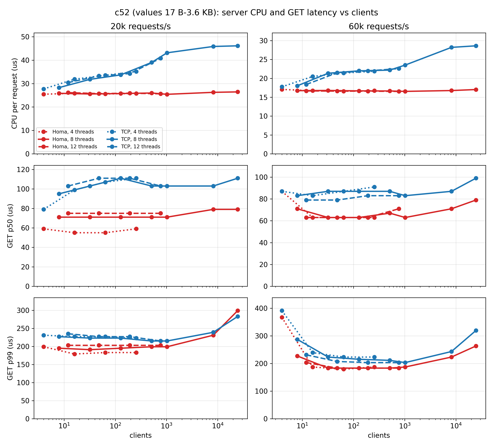
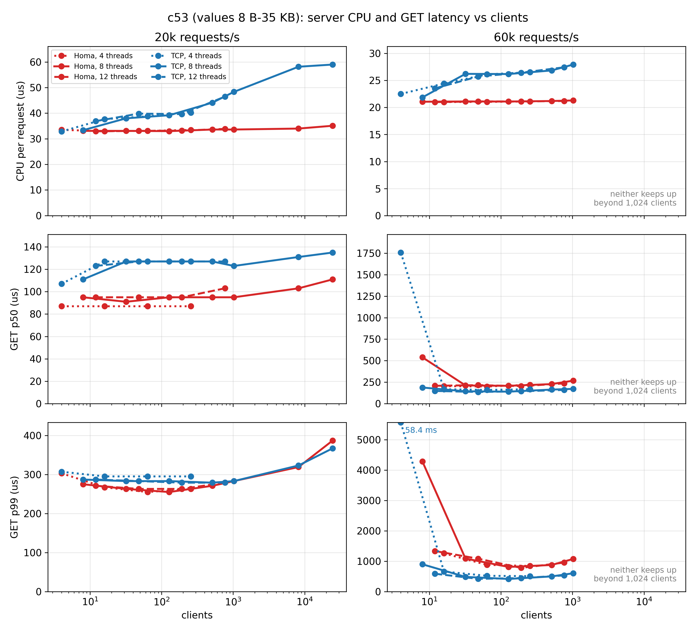
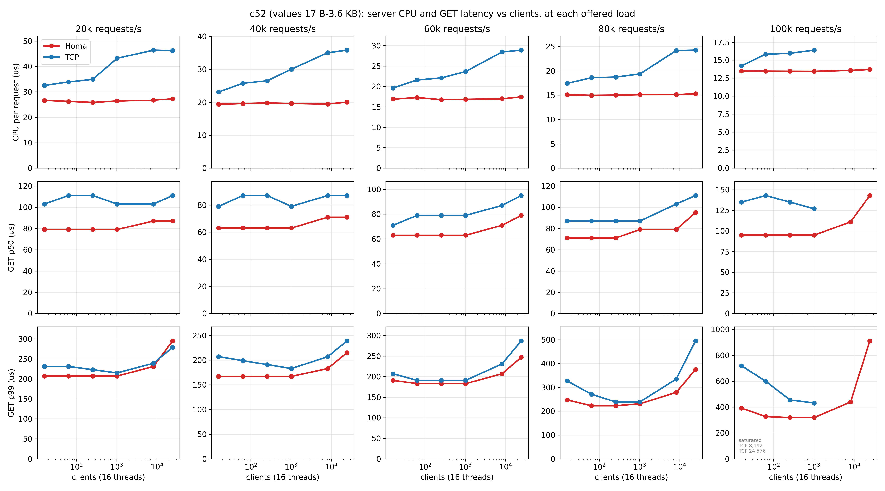
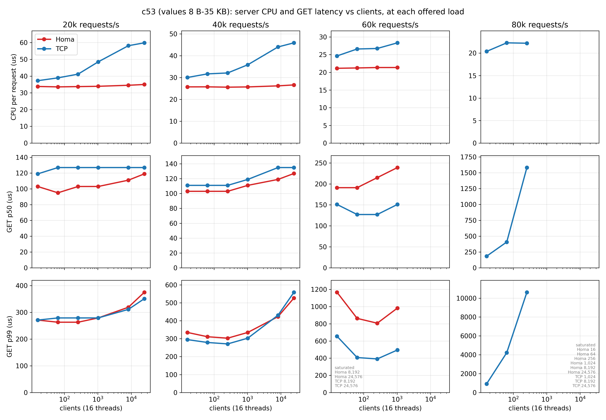
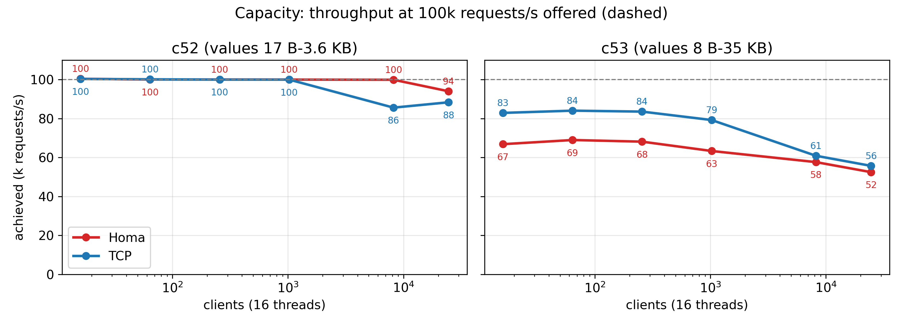

# Redis over Homa vs TCP: a client fleet against one Redis shard

One single-threaded Redis shard serving 4 to 24,576 independent clients over Homa and over
TCP, on 2x CloudLab Utah xl170 (25 Gb/s), with request sizes and mixes from the Twitter cache
trace.

## Client, server and threading model

| Component | Repository and version | Role |
|---|---|---|
| Homa | <https://github.com/PlatformLab/HomaModule/tree/1c59d7b6>, `main` @ `1c59d7b6` | kernel module, `sch_homa`, the CloudLab `config` tool |
| Redis with a Homa transport | <https://github.com/uoenoplab/smt-redis/tree/homa-6.17.8>, branch `homa-6.17.8` @ `f749cd4dd` | the server (and `redis-cli` for preload checks) |
| memtier_benchmark with Homa | <https://github.com/uoenoplab/memtier_benchmark/tree/homa>, branch `homa`: `7f8b5a3` (the branch tip) for latency, `9006af8` for capacity (on <https://github.com/redis/memtier_benchmark/tree/7a6394e> `7a6394e`) | the client fleet |
| Scripts | this branch: `fleet-xl170.sh`, `tcpclean.sh`, `busy-cores.sh`, `homa-timer-busy.sh`, `memtier-ab.sh`, `plot.py` | runs, host state, CPU sampling, figures |

**Server** (node0): one redis-server process with a single event-loop thread (`--io-threads 1`)
pinned to CPU 7; it parses and executes every command. Over TCP each client has its own socket and
the event loop polls all of them with epoll. Over Homa one socket serves every client: when it is
readable, the event loop drains the ready RPCs with `recvmsg` and hands each to the Redis client
object of its peer (ip:port), which runs the commands; each RPC's replies leave as one `sendmsg`.

**Load generator**: memtier_benchmark is Redis Ltd.'s open-source load generator for Redis and
Memcached (<https://github.com/redis/memtier_benchmark/tree/master>). It emulates many clients from one
process: worker threads, each running a libevent loop that drives many client connections, every
connection speaking the Redis protocol and recording per-request latency into HDR histograms. Our
fork adds a Homa transport (each client one Homa socket, the protocol code unchanged), open-loop
Poisson arrivals and request mixes drawn from a trace (see Changes below).

**Clients** (node1): one memtier_benchmark process with T worker threads on CPUs 0-3, 5-13 and
15-18. Each thread runs one libevent loop that drives C clients, N = T x C in all. A client is one
TCP connection or one Homa socket with one request in flight (`--pipeline=1`): its next request
goes out only after the reply arrives. Each client's requests arrive as a Poisson process of
LOAD/N per second; an arrival that finds the previous request still in flight waits for it.

**Three sweeps**, one varying the number of clients, one the load, and one measuring capacity:

| Sweep | Clients N | Threads x clients per thread | Load (requests/s) | memtier | Latency from | Rounds | xl170 pair |
|---|---|---|---|---|---|---|---|
| clients | 4 - 24,576 | 4, 8, 12 x 1, 4, 16, 64; 8 x 128, 1,024, 3,072 | 20k, 60k | `7f8b5a3` | the request's arrival | 2 | 1 (2026-10-06) |
| load | 16 - 24,576 | 16 x 1, 4, 16, 64, 512, 1,536 | 20k - 100k, step 20k | `7f8b5a3` | the request's arrival | 3 | 2 (2026-10-19) |
| capacity | 16 - 24,576 | 16 x 1, 4, 16, 64, 512, 1,536 | 100k | `9006af8` | (throughput only) | 3 | 2 |

The two pairs agree: the load sweep's 1,024 to 24,576-client points, also run on pair 1, match within
3% in server CPU per request, and so do the capacities but at one bistable point (see Limitations).

**Kernel**: the NIC interrupts (NAPI) of the node pair's traffic are on node0 CPU 1 and node1 CPU 4,
which the applications avoid (the receive queue the pair's traffic hashes to changes with every boot;
its interrupt is moved to these CPUs, see Reproduce); Homa's `homa_timer` kthread is pinned to CPU 19
on both nodes.

**Runs**: a fresh redis-server once node0 is idle; 100,000 keys preloaded; 5 s warm-up (not
counted); 20 s measured; CPU sampled for 4 s mid-run as MPERF/TSC on every CPU of both nodes;
3 rounds, medians reported.

## Test rationale

- **The simplest exchange.** Each client sends one request and waits for its reply before the
  next (one request in flight), as an application thread does with a synchronous client library
  (redis-py, Jedis, hiredis) and a connection pool.
- **Many clients contending for one server core.** Thousands of such clients share one Redis
  core, so requests from different clients queue behind each other at the server: head-of-line
  blocking across clients, made worse when a small reply waits behind another client's large one.
  This is where the transports differ: TCP keeps a socket per client, Homa one for all, and Homa
  sends the shortest remaining message first.
- **Not head-of-line blocking within one stream.** Redis executes a client's commands in order on
  one thread, so a client that pipelines many requests over one connection is serialized by Redis
  anyway; letting a later reply overtake an earlier one in the transport gains little, and Homa's
  per-message cost (one `recvmsg` and one `sendmsg` per request, where TCP batches several requests
  per read) makes it lose there. We therefore do not pipeline.

When each Homa property should help, and what cancels it:

| Homa property | Pays off when | Cancelled when | Here |
|---|---|---|---|
| Connectionless: the server's kernel state does not grow with the number of clients (one socket for all; TCP keeps one socket per client) | many clients | few clients each sending densely, where TCP batches by itself | 4-24,576 clients, one request in flight each |
| Message-based, shortest remaining message first: a small reply is not queued behind another client's large one | sizes mixed across clients, egress the bottleneck | ordering inside one client, or a single-threaded endpoint that must process a large message whole | c53 mixes 8 B to 35 KB |
| Receiver-driven grants: incast without loss | many senders replying to one receiver | (needs more than two machines) | not tested |

### The workloads: c52 and c53

c52 and c53 are two clusters of Twitter's in-memory cache (Twemcache) trace: one week of requests
to 54 production clusters, published with Yang, Yue and Rashmi, "A large scale analysis of hundreds
of in-memory cache clusters at Twitter", OSDI 2020 (<https://github.com/twitter/cache-trace/tree/master>). We
used the sampled per-cluster files from CMU PDL
(<https://ftp.pdl.cmu.edu/pub/datasets/twemcacheWorkload/open_source/>, `clusterNN.sort.sample100.zst`):
the first 20,000,000 requests of cluster 52 and all 2,468,148 of cluster 53.

| | c52 | c53 |
|---|---|---|
| Trace statistics (the paper's table) | 24.3k requests/s, third busiest of 54; mean key 20 B, mean value 273 B; get 91%, add 4%, gets 2%, cas 2%; Zipf 1.21 | 1.4k requests/s; mean key 36 B, mean value 9.2 KB; get 89%, prepend 9%, set 3%; Zipf 1.21 |
| Why this cluster | the busiest whose mean value exceeds 100 B (the two busier ones average 8 B and 37 B, single-packet messages) | values spread over four orders of magnitude: the mix where a small reply can queue behind a large one |
| GET value sizes, weighted by requests | 17 B-3.6 KB; 58% are 27 B | 8 B-35 KB; 25% over 16 KB |
| SET:GET | 7:93 | 13:87 |

How the memtier inputs were built from the trace: the value sizes of GET/GETS requests that hit
(value size > 0) were binned at a factor of 1.41 (half a power of two); each bin became one
`size:weight` entry of `--data-size-list`, the bin's median size weighted by its share of requests
(per 10,000). The SET:GET ratio counts every write type (set, add, cas, replace, prepend, append,
incr, decr) as a SET. Keys are not taken from the trace: 100,000 keys drawn uniformly, all
preloaded, so every GET hits.

| Workload | `--data-size-list` (size in bytes : weight per 10,000 GETs) |
|---|---|
| c52 | `17:38,27:5751,38:199,54:39,70:23,117:10,151:240,216:383,306:531,434:732,607:1172,753:605,1149:220,1543:51,2403:3,3648:5` |
| c53 | `8:717,16:304,24:251,40:713,56:310,72:215,98:241,128:73,231:41,280:91,432:322,528:79,912:1009,1136:388,1749:30,2574:41,3432:73,5049:125,7326:514,9801:323,13695:1594,18711:386,26961:1592,35343:567` |

## Results

The clients sweep holds the load at 20k or 60k requests/s and varies the number of clients from 4
to 24,576; the load sweep holds the clients at 16 to 24,576 and raises the load from 20k to 100k
requests/s. Latency is reported only where the median achieved load is within 0.5% of the offered
load (three standard deviations of a Poisson count over 20 s at 20k/s). A point short of that has a
backlog, and as latency counts from each request's arrival it grows toward N / achieved, every
client waiting: TCP with 8,192 clients at 60k achieved 99.4% with a GET p50 of 143 ms = 8,192 /
59.6k. Every run at 20k and 40k requests/s achieved its offered load within 0.7%. Capacity is the
throughput at 100k offered, from separate runs (see Limitations for why).

### 4 to 24,576 clients: server CPU and GET latency




The figures draw each client thread count as its own line (solid: 8 threads, the one that spans 8
to 24,576 clients; dotted: 4; dashed: 12, both 4 to 768 clients). Their CPU per request falls on one
curve: the server's cost depends on the number of clients, not on how the client host drives them.

- **Server CPU**: TCP's cost per request grows with the number of clients from the first
  connections on; Homa's does not. With 4 clients both spend about the same node0 CPU per request
  (c52 at 60k: 17.1 us over Homa, 17.8 over TCP; c53 at 20k: 33.5 and 32.8). At 24,576 clients TCP
  spends 28.6 us (c52, 60k) and 59.0 us (c53, 20k), Homa 17.0 and 35.1: TCP costs 1.7x as much.
  Homa's cost stays within 7% over the whole range.
- **c52 (small values)**: Homa's GET p50 is 23-49% lower at 20k and up to 31% lower at 60k (equal
  with 4 clients); its p99 is lower at every client count but 24,576 at 20k (299 vs 283 us).
- **c53 (mixed sizes)**: at 20k Homa's p50 is 14-31% lower and the p99s are within 14%. At 60k,
  close to Homa's c53 capacity, TCP's p50 and p99 are lower (p99 1.7-2.6x from 12 to 1,024
  clients); from 8,192 clients neither keeps up with 60k.
- At 60k with 4 clients each client carries 15k requests/s with one request in flight, near what one
  client can do; with c53 that point measures the clients (TCP's p99 58 ms, Homa does not keep up).
- Homa's c52 p50 at 20k depends on the client thread count (55-59 us with 4 threads, 71-79 with 8 or
  12, 79-87 with the load sweep's 16); the cause is not established.

### Load and capacity, 16 to 24,576 clients





- **Server CPU**: as in the clients sweep, at every load. Homa's cost per request does not depend on
  the number of clients (c52 at 20k: 25.8-27.3 us from 16 to 24,576 clients); TCP's grows with it
  (32.5 to 46.4 us), 1.2x Homa's with 16 clients and 1.7x with 8,192 or more. The gap narrows as
  the load rises: at 100k TCP spends 1.05x Homa's with 16 clients and 1.22x with 1,024.
- **c52 (small values)**: wherever both keep up, Homa's GET p50 is 9-34% lower and its p99 3-46%
  lower, but at 24,576 clients and 20k (p99 295 vs 279 us). TCP reaches 100k with up to 1,024
  clients and saturates at 85.6k (8,192) and 88.4k (24,576). Homa reaches 100k with up to 8,192;
  at 24,576 it does in 4 of 12 runs and saturates at 91-97k in the other 8 (see Limitations).
- **c53 (mixed sizes)**: at 20k and 40k Homa's p50 is 6-25% lower and the p99s are within 14%. At
  60k, which Homa sustains with up to 1,024 clients, its p50 is 1.3-1.7x TCP's and its p99 1.8-2.1x.
  TCP's capacity is higher at every client count: 82.9k vs 66.8k (16 clients), 84.1k vs 69.0k (64),
  83.6k vs 68.1k (256), 79.2k vs 63.3k (1,024), 60.9k vs 57.6k (8,192), 55.7k vs 52.5k (24,576).
  At saturation TCP's busiest node0 CPU runs at 93-100%, Homa's at 87-92%; what stops Homa short of
  a full core is not established.
- **Past saturation Homa's timers grow**: with thousands of requests waiting, `homa_timer` takes
  33-66% of a node0 CPU and 86-96% of a node1 CPU (c53, 8,192 and 24,576 clients), and node0's busy
  CPUs sum to 278-327%, against 132-136% in the capacity runs with 256 clients or fewer.

### Tables

Each cell: GET p50 / p99 (us), node0 CPU per request (us); "saturated": the transport did not
keep up (its capacity is in the last table).

Clients sweep:

**c52**: GET p50 / p99 (us), node0 CPU per request (us)

| threads x clients per thread | clients | 20k Homa | 20k TCP | 60k Homa | 60k TCP |
|---:|---:|---:|---:|---:|---:|
| 4 x 1 | 4 | 59 / 199, 25.5 | 79 / 231, 27.7 | 87 / 367, 17.1 | 87 / 391, 17.8 |
| 4 x 4 | 16 | 55 / 179, 25.9 | 99 / 227, 31.9 | 63 / 187, 16.7 | 83 / 239, 20.5 |
| 4 x 16 | 64 | 55 / 183, 25.6 | 107 / 227, 33.5 | 63 / 179, 16.6 | 87 / 223, 21.4 |
| 4 x 64 | 256 | 59 / 183, 25.7 | 111 / 223, 35.1 | 63 / 187, 16.8 | 91 / 223, 21.9 |
| 8 x 1 | 8 | 71 / 195, 25.8 | 95 / 227, 28.3 | 71 / 227, 16.7 | 83 / 287, 18.0 |
| 8 x 4 | 32 | 71 / 191, 25.6 | 103 / 223, 31.8 | 63 / 183, 16.8 | 87 / 223, 21.4 |
| 8 x 16 | 128 | 71 / 195, 25.7 | 111 / 223, 33.7 | 63 / 183, 16.7 | 87 / 215, 22.0 |
| 8 x 64 | 512 | 71 / 199, 26.0 | 103 / 215, 39.0 | 67 / 183, 16.7 | 87 / 211, 22.2 |
| 8 x 128 | 1,024 | 71 / 199, 25.4 | 103 / 215, 43.1 | 63 / 187, 16.6 | 83 / 203, 23.5 |
| 8 x 1024 | 8,192 | 79 / 231, 26.3 | 103 / 239, 45.8 | 71 / 223, 16.8 | 87 / 243, 28.2 |
| 8 x 3072 | 24,576 | 79 / 299, 26.4 | 111 / 283, 46.1 | 79 / 263, 17.0 | 99 / 319, 28.6 |
| 12 x 1 | 12 | 75 / 203, 26.1 | 103 / 235, 30.4 | 63 / 203, 16.7 | 79 / 231, 18.4 |
| 12 x 4 | 48 | 75 / 203, 25.7 | 111 / 227, 33.3 | 63 / 183, 16.6 | 79 / 207, 21.5 |
| 12 x 16 | 192 | 75 / 203, 25.9 | 111 / 227, 34.3 | 63 / 183, 16.6 | 83 / 203, 22.0 |
| 12 x 64 | 768 | 75 / 203, 25.6 | 103 / 215, 40.8 | 71 / 183, 16.5 | 83 / 203, 22.6 |

**c53**: GET p50 / p99 (us), node0 CPU per request (us)

| threads x clients per thread | clients | 20k Homa | 20k TCP | 60k Homa | 60k TCP |
|---:|---:|---:|---:|---:|---:|
| 4 x 1 | 4 | 87 / 303, 33.5 | 107 / 307, 32.8 | saturated | 1759 / 58367, 22.5 |
| 4 x 4 | 16 | 87 / 267, 33.0 | 127 / 295, 37.7 | 203 / 1259, 21.0 | 167 / 659, 24.4 |
| 4 x 16 | 64 | 87 / 255, 33.1 | 127 / 295, 38.8 | 199 / 879, 21.0 | 159 / 519, 26.1 |
| 4 x 64 | 256 | 87 / 263, 33.5 | 127 / 295, 40.2 | 219 / 843, 21.1 | 167 / 507, 26.5 |
| 8 x 1 | 8 | 95 / 275, 33.1 | 111 / 287, 33.4 | 539 / 4287, 21.1 | 187 / 899, 21.9 |
| 8 x 4 | 32 | 91 / 263, 33.1 | 127 / 283, 38.0 | 211 / 1087, 21.1 | 143 / 483, 26.2 |
| 8 x 16 | 128 | 95 / 255, 33.0 | 127 / 283, 39.2 | 207 / 811, 21.1 | 139 / 415, 26.2 |
| 8 x 64 | 512 | 95 / 271, 33.6 | 127 / 279, 44.1 | 227 / 875, 21.2 | 163 / 499, 26.8 |
| 8 x 128 | 1,024 | 95 / 283, 33.6 | 123 / 283, 48.3 | 267 / 1075, 21.3 | 171 / 603, 27.9 |
| 8 x 1024 | 8,192 | 103 / 319, 34.0 | 131 / 323, 58.1 | saturated | saturated |
| 8 x 3072 | 24,576 | 111 / 387, 35.1 | 135 / 367, 59.0 | saturated | saturated |
| 12 x 1 | 12 | 95 / 271, 32.9 | 123 / 287, 36.9 | 207 / 1335, 21.0 | 147 / 587, 23.5 |
| 12 x 4 | 48 | 95 / 263, 33.1 | 127 / 283, 39.8 | 215 / 1083, 21.1 | 135 / 419, 25.7 |
| 12 x 16 | 192 | 95 / 263, 33.2 | 127 / 279, 39.6 | 203 / 779, 21.1 | 143 / 443, 26.4 |
| 12 x 64 | 768 | 103 / 279, 33.9 | 127 / 279, 46.5 | 235 / 955, 21.2 | 159 / 531, 27.4 |

Load sweep:

**c52**: GET p50 / p99 (us), node0 CPU per request (us)

| clients | load | Homa | TCP |
|---:|---:|---:|---:|
| 16 | 20k | 79 / 207, 26.6 | 103 / 231, 32.5 |
| 16 | 40k | 63 / 167, 19.4 | 79 / 207, 23.1 |
| 16 | 60k | 63 / 191, 16.9 | 71 / 207, 19.6 |
| 16 | 80k | 71 / 247, 15.1 | 87 / 327, 17.4 |
| 16 | 100k | 95 / 391, 13.5 | 135 / 719, 14.2 |
| 64 | 20k | 79 / 207, 26.2 | 111 / 231, 33.9 |
| 64 | 40k | 63 / 167, 19.6 | 87 / 199, 25.8 |
| 64 | 60k | 63 / 183, 17.3 | 79 / 191, 21.6 |
| 64 | 80k | 71 / 223, 15.0 | 87 / 271, 18.6 |
| 64 | 100k | 95 / 327, 13.5 | 143 / 599, 15.8 |
| 256 | 20k | 79 / 207, 25.8 | 111 / 223, 34.9 |
| 256 | 40k | 63 / 167, 19.8 | 87 / 191, 26.5 |
| 256 | 60k | 63 / 183, 16.8 | 79 / 191, 22.1 |
| 256 | 80k | 71 / 223, 15.0 | 87 / 239, 18.7 |
| 256 | 100k | 95 / 319, 13.5 | 135 / 455, 16.0 |
| 1,024 | 20k | 79 / 207, 26.4 | 103 / 215, 43.2 |
| 1,024 | 40k | 63 / 167, 19.6 | 79 / 183, 30.0 |
| 1,024 | 60k | 63 / 183, 16.9 | 79 / 191, 23.7 |
| 1,024 | 80k | 79 / 231, 15.1 | 87 / 239, 19.4 |
| 1,024 | 100k | 95 / 319, 13.5 | 127 / 431, 16.4 |
| 8,192 | 20k | 87 / 231, 26.7 | 103 / 239, 46.4 |
| 8,192 | 40k | 71 / 183, 19.5 | 87 / 207, 35.0 |
| 8,192 | 60k | 71 / 207, 17.0 | 87 / 231, 28.5 |
| 8,192 | 80k | 79 / 279, 15.1 | 103 / 335, 24.2 |
| 8,192 | 100k | 111 / 439, 13.6 | saturated |
| 24,576 | 20k | 87 / 295, 27.3 | 111 / 279, 46.2 |
| 24,576 | 40k | 71 / 215, 20.0 | 87 / 239, 35.8 |
| 24,576 | 60k | 79 / 247, 17.5 | 95 / 287, 28.9 |
| 24,576 | 80k | 95 / 375, 15.3 | 111 / 495, 24.3 |
| 24,576 | 100k | 143 / 911, 13.7 | saturated |

**c53**: GET p50 / p99 (us), node0 CPU per request (us)

| clients | load | Homa | TCP |
|---:|---:|---:|---:|
| 16 | 20k | 103 / 271, 33.8 | 119 / 271, 37.3 |
| 16 | 40k | 103 / 335, 25.7 | 111 / 295, 30.0 |
| 16 | 60k | 191 / 1167, 21.1 | 151 / 655, 24.6 |
| 16 | 80k | saturated | 183 / 919, 20.4 |
| 16 | 100k | saturated | saturated |
| 64 | 20k | 95 / 263, 33.6 | 127 / 279, 38.9 |
| 64 | 40k | 103 / 311, 25.7 | 111 / 279, 31.7 |
| 64 | 60k | 191 / 863, 21.2 | 127 / 407, 26.6 |
| 64 | 80k | saturated | 407 / 4223, 22.3 |
| 64 | 100k | saturated | saturated |
| 256 | 20k | 103 / 263, 33.7 | 127 / 279, 41.2 |
| 256 | 40k | 103 / 303, 25.6 | 111 / 271, 32.1 |
| 256 | 60k | 215 / 807, 21.4 | 127 / 391, 26.7 |
| 256 | 80k | saturated | 1583 / 10623, 22.2 |
| 256 | 100k | saturated | saturated |
| 1,024 | 20k | 103 / 279, 33.9 | 127 / 279, 48.5 |
| 1,024 | 40k | 111 / 335, 25.7 | 119 / 303, 35.9 |
| 1,024 | 60k | 239 / 983, 21.4 | 151 / 495, 28.3 |
| 1,024 | 80k | saturated | saturated |
| 1,024 | 100k | saturated | saturated |
| 8,192 | 20k | 111 / 319, 34.5 | 127 / 311, 58.2 |
| 8,192 | 40k | 119 / 423, 26.2 | 135 / 431, 44.0 |
| 8,192 | 60k | saturated | saturated |
| 8,192 | 80k | saturated | saturated |
| 8,192 | 100k | saturated | saturated |
| 24,576 | 20k | 119 / 375, 35.0 | 127 / 351, 59.9 |
| 24,576 | 40k | 127 / 527, 26.6 | 135 / 559, 45.9 |
| 24,576 | 60k | saturated | saturated |
| 24,576 | 80k | saturated | saturated |
| 24,576 | 100k | saturated | saturated |

**Capacity**: achieved at 100k requests/s offered (k requests/s, memtier `9006af8`)

| clients | c52 Homa | c52 TCP | c53 Homa | c53 TCP |
|---:|---:|---:|---:|---:|
| 16 | 100.4 | 100.3 | 66.8 | 82.9 |
| 64 | 100.0 | 100.1 | 69.0 | 84.1 |
| 256 | 100.0 | 100.0 | 68.1 | 83.6 |
| 1,024 | 100.0 | 100.0 | 63.3 | 79.2 |
| 8,192 | 99.9 | 85.6 | 57.6 | 60.9 |
| 24,576 | 94.0 | 88.4 | 52.5 | 55.7 |

## Changes over the earlier Homa Redis

The earlier Homa port (uoenoplab/smt-redis branch `smt`, 2024) was Redis 7.2.4 against the 2024
Homa user API, chose the transport by port range (5xxx / 6xxx / 8xxx), and its redis-benchmark
blocked on each Homa receive. The version measured here:

- **Redis 8.10.1 and the current Homa API**: the receive pool is an mmap region registered with
  `SO_HOMA_RCVBUF`, buffer pages are recycled across `recvmsg` calls, and `sendmsg` carries
  `homa_sendmsg_args`; the old `homa_hl.c` wrappers are gone.
- **Homa as a Redis `ConnectionType`**, chosen explicitly (`--homa-port`, `redis-cli --homa`), not by
  port range. One socket per listener; a dispatcher drains ready RPCs and hands each to a per-peer
  Redis client (keyed by ip:port), so per-client state (SELECT, MULTI, ...) and command order behave
  as over a TCP connection. One RPC in flight per peer; later ones wait in a queue with their own
  bytes. New peers pass Redis's admission (maxclients, protected mode); idle peers are reaped.
- **Replies leave as one Homa message straight from the client's output buffers** (one `writev`,
  values of 16 KB and more by reference); an RPC without output gets a 1-byte no-reply message, a
  reply over Homa's 1 MB limit an error; a send that hits `EAGAIN` is retried on `EPOLLOUT`.
- **No empty event-loop turn per RPC**: the pending-data hook marks a peer only when it has another
  RPC queued (without this, every reply kept the next `epoll_wait` from sleeping).
- **Client side**: a Homa transport in Redis's vendored hiredis (`redisConnectHoma`), used by
  `redis-cli` and a nonblocking `redis-benchmark`; one RPC in flight per context (Homa may complete
  a later, smaller response first); closing a context sends QUIT, since Homa has no FIN.
- **Load generator** (new): memtier_benchmark with `--homa` (each client one Homa socket, memtier's
  protocol code unchanged), `--rate-poisson` (open-loop Poisson arrivals on absolute times),
  `--sample-mix` (request type and value size drawn per request from the trace's weights),
  `--warmup` and `--no-per-second-percentiles` (per-client per-second percentile summaries stall
  worker threads at thousands of clients).

## Reproduce

| Item | Value |
|---|---|
| Nodes | 2x CloudLab Utah xl170 (`small-lan` profile, LAN on 10.0.1.x): node0 = 10.0.1.1 (Redis), node1 = 10.0.1.2 (clients) |
| Hardware | Intel Xeon E5-2640 v4 (10 cores / 20 threads), Mellanox ConnectX-4 25 Gb/s (`ens1f1np1`) |
| OS | Ubuntu 24.04, mainline kernel 6.17.8-061708-generic, `mitigations=off`, governor `performance` |
| Homa | PlatformLab/HomaModule `main` @ `1c59d7b6` |
| Redis | uoenoplab/smt-redis branch `homa-6.17.8` @ `f749cd4dd`: Redis 8.10.1 with a Homa transport |
| Load generator | uoenoplab/memtier_benchmark branch `homa`: `7f8b5a3` (latency, from the arrival) and `9006af8` (capacity: counts every request sent after the warm-up), on redis/memtier_benchmark `7a6394e` |

### Build (both nodes for Homa and Redis, node1 for memtier)

```bash
git clone https://github.com/PlatformLab/HomaModule ~/homaModule && cd ~/homaModule && git checkout 1c59d7b6  # install_homa expects ~/homaModule
cp -r cloudlab/bin/. ~/bin/ && for f in bashrc bash_profile gdbinit; do cp cloudlab/$f ~/.$f; done   # install_homa copies these to every node
make -j20 CC=gcc-14 && make -j20 -C util
~/bin/install_homa 2          # from node0: copies homa.ko and tools to both nodes, runs "config default"
git clone -b homa-6.17.8 https://github.com/uoenoplab/smt-redis ~/smt-redis && git -C ~/smt-redis checkout f749cd4dd && make -C ~/smt-redis -j20
# node1
sudo apt-get install -y build-essential autoconf automake libpcre3-dev libevent-dev pkg-config zlib1g-dev libssl-dev
git clone -b homa https://github.com/uoenoplab/memtier_benchmark ~/memtier_benchmark
cd ~/memtier_benchmark && autoreconf -ivf && ./configure && make -j16   # 7f8b5a3, for latency
cp -r ~/memtier_benchmark ~/memtier-9006af8 && cd ~/memtier-9006af8 && git checkout 9006af8 && make -j16   # for capacity
```

### Host configuration of each protocol

| | Homa (official CloudLab config) | TCP (kernel defaults, Homa removed) |
|---|---|---|
| Module | `homa.ko` loaded; `num_priorities 8`, `link_mbps 25000`, `unsched_bytes 60000`, `max_incoming 480000`, `max_gso_size 10000`, `max_nic_est_backlog_usecs 5` | `homa.ko` unloaded (`rmmod homa`) |
| qdisc | `mq` with `sch_homa` on all 20 TX queues | `mq` with `fq_codel` (kernel default) |
| RPS / RFS | RPS on every RX queue (mask `fffff`), `rps_sock_flow_entries 32768`, `rps_flow_cnt 2048` | off (RSS only) |
| NIC | `ethtool -C`: `adaptive-rx off rx-usecs 0 rx-frames 1 adaptive-tx off tx-usecs 5`; `-K ntuple off` | same (left as Homa's config set it) |
| Command | `bash -lc "config default"` on each node (`tcpclean.sh off`) | `tcpclean.sh on`: `config reset_qdisc`; `rps_cpus`/`rps_flow_cnt` 0; `rps_sock_flow_entries 0`; `rmmod homa` |
| redis-server | `redis-server --port 6379 --homa-port 2000 --bind 0.0.0.0 --protected-mode no --save "" --io-threads 1 --maxclients 100000` | the same without `--homa-port 2000` |
| Client | `memtier ... -p 2000 --homa` | `memtier ... -p 6379` |

Both: `net.ipv4.icmp_ratelimit=0` on both nodes (a Homa server RPC whose client closed is otherwise
probed every 1 ms until an ICMP gets through); node1 `ip_local_port_range "1024 65535"`,
`tcp_tw_reuse 1`; `ulimit -n 200000`; the `homa_timer` kthread pinned to CPU 19 on both nodes;
NAPI on node0 CPU 1 and node1 CPU 4, so redis-server runs on node0 CPU 7 and memtier on node1 CPUs
0-3, 5-13, 15-18. Which receive queue the pair's traffic lands on (Homa and ICMP get the same 2-tuple
RSS hash) depends on the boot's random RSS key: run `sudo ping -f -c 50000 10.0.1.1` from node1 and
compare the `rxN_packets` counters of `ethtool -S ens1f1np1` on each node before and after, then swap
two IRQ affinities (`/proc/irq/<irq>/smp_affinity_list`; irqbalance is off): the found queue's
`mlx5_compN` interrupt to CPU 1 (node0) or 4 (node1), and the interrupt that was on that CPU to the
found queue's old CPU. On pair 2, node0 received on queue 19 and node1 on 13.

The memtier command of one run (c52, 8,192 clients, 60k requests/s; `--rate-poisson` = LOAD/N):

```bash
memtier_benchmark -s 10.0.1.1 -p 2000 --homa --protocol=redis -t 16 -c 512 --pipeline=1 \
  --rate-poisson=7.32421875 --ratio=7:93 --key-pattern=R:R --key-minimum=1 --key-maximum=100000 \
  --data-size-list=17:38,27:5751,38:199,54:39,70:23,117:10,151:240,216:383,306:531,434:732,607:1172,753:605,1149:220,1543:51,2403:3,3648:5 \
  --sample-mix --randomize --distinct-client-seed --warmup=5 --test-time=20 --no-per-second-percentiles --hide-histogram
```

The preload before it, over TCP: the same with `-p 6379 -t 4 -c 8 --ratio=1:0 --key-pattern=P:P -n allkeys`.

### Run (node1, about 8.5 h)

```bash
for h in node0 node1; do scp busy-cores.sh homa-timer-busy.sh $h:; done   # node1 also needs hoststate.sh, tcpclean.sh, fleet-xl170.sh
tmux new -d -s fleet '
  load()     { CPT="1 4 16 64 512 1536" TRANSPORTS=$1 bash fleet-xl170.sh > load-$1.csv; }
  capacity() { M=~/memtier-9006af8/memtier_benchmark CPT="1 4 16 64 512 1536" LOADS=100000 TRANSPORTS=$1 bash fleet-xl170.sh > capacity-$1.csv; }
  clients()  { ( LOADS="20000 60000" ROUNDS=2 TRANSPORTS=$1
                 THREADS="4 8 12" CPT="1 4 16 64" bash fleet-xl170.sh
                 THREADS=8 CPT="128 1024 3072" bash fleet-xl170.sh | tail -n +2 ) > clients-$1.csv; }
  set -eo pipefail   # any failed check stops the chain
  for s in load capacity clients; do $s homa; done; bash tcpclean.sh on
  for s in load capacity clients; do $s tcp; done; bash tcpclean.sh off'
bash memtier-ab.sh > memtier-ab.csv   # optional, Homa config: the two memtier versions past saturation
uv run --with matplotlib python plot.py
```

Every script checks the state it relies on and stops with the reason instead of going on:
`hoststate.sh homa|tcp` checks both nodes (Homa's config: homa.ko loaded, sch_homa on all 20 TX
queues, RPS/RFS on, nothing but those qdiscs holding homa.ko; TCP alone: homa.ko unloaded, no
sch_homa, RPS/RFS off; and no memtier left on node1). `tcpclean.sh` ends with it, and
`fleet-xl170.sh` runs it before every run, then stops on a server that does not start, a short
preload, a memtier that fails or reports errors or misses, and a missing CPU sample. A process with
a Homa socket open keeps homa.ko in use: rmmod then fails, and so does `config default` at insmod,
before it sets RPS and sch_homa.

| File | What |
|---|---|
| `fleet-xl170.sh` | runs the experiment: fresh server, preload, memtier, CPU sampling; one CSV row per run |
| `tcpclean.sh`, `hoststate.sh` | switch between TCP alone and Homa's config; check that both nodes are in the state the runs need |
| `busy-cores.sh`, `homa-timer-busy.sh` | per-CPU busy % (MPERF/TSC); busy % of the `homa_timer` kthread |
| `memtier-ab.sh` | memtier `9006af8` against `7f8b5a3`, interleaved, at two points past saturation |
| `results/clients-{homa,tcp}.csv`, `results/load-{homa,tcp}.csv`, `results/capacity-{homa,tcp}.csv` | the clients, load and capacity sweeps, one row per run; `server_busy_sum` is the sum of node0's per-CPU busy % |
| `results/memtier-ab.csv` | `memtier-ab.sh`'s runs: a `memtier` column, then the same columns |
| `plot.py` | the figures and tables |

## Limitations

- **One client host.** node1 holds every Homa socket; `homa_timer`, which visits every socket each
  tick, takes 38% of a CPU at 8,192 clients and 66% at 24,576 (c52, 100k, kept up). c52 at 24,576
  clients and 100k is bistable: 4 of 12 runs keep up (node1's `homa_timer` 66%, node0's CPUs 137%
  busy in all), 8 saturate at 91-97k (`homa_timer` 90-95%, node0 275-323%), with either memtier;
  what decides which is not established. A real fleet spreads its sockets over many hosts, and
  Homa's server would then track many peers.
- **Latency counts from each request's arrival** (memtier `7f8b5a3`): a request that arrives while
  its client's previous one is in flight waits, and the wait counts. Pair 1's earlier load sweep
  counted from the send (`9006af8`), which hides that wait: with 1,024 clients at 20k it gave a GET
  p50 of 55 us for Homa and 87 for TCP, against 79 and 103 from the arrival.
- **Throughput past saturation comes from `9006af8`.** memtier leaves out requests that started
  before the warm-up ended, and `7f8b5a3` dates a request by its arrival, so past saturation, with
  seconds of backlog, it leaves out completions whose arrival fell in the warm-up and undercounts
  what the server did: c53 Homa, 1,024 clients, 100k gave 53.3-55.2k against 63.1-64.0k from
  `9006af8`, interleaved on the same pair with node0 equally busy (`results/memtier-ab.csv`). The
  sweeps therefore report only that a point did not keep up; capacity comes from separate `9006af8`
  runs. Points that keep up have no backlog and are not affected.
- Near saturation the CPU per request of both transports is inflated; only sustained points are
  compared. What limits Homa at saturation (node0's busiest CPU 87-92% busy, against 93-100% for
  TCP) is not established.
- **Two xl170 pairs.** The clients sweep ran on pair 1, the load and capacity sweeps on pair 2 with
  the NIC interrupts moved to the same CPUs. Where both pairs measured (1,024 to 24,576 clients, all
  loads), server CPU per request agrees within 3%, and capacity within 3% but at c52 Homa with
  24,576 clients (88.4k on pair 1, median 94.0k on pair 2: the bistable point above).
- The TCP runs ran as one block after the Homa runs (`homa.ko` can only be unloaded with no
  Homa socket open). Keys are drawn uniformly, not with the trace's skew; every write is a SET.

## Changelog

- **2026-10-06/07** (pair 1): clients sweep (4 to 24,576 clients, latency from the arrival) and load
  sweep (1,024 to 24,576 clients, latency from the send); TCP reruns with `homa.ko` unloaded on node1.
- **2026-10-19** (pair 2): load sweep rerun from 16 to 24,576 clients with latency from the arrival;
  capacity from separate `9006af8` runs, after an interleaved A/B showed `7f8b5a3` undercounts past
  saturation; a point keeps up within 0.5% (was 2%); c52 at 24,576 clients and 100k found bistable;
  NAPI placement procedure; build fixes (`install_homa` needs `~/homaModule` and Homa's dotfiles).
